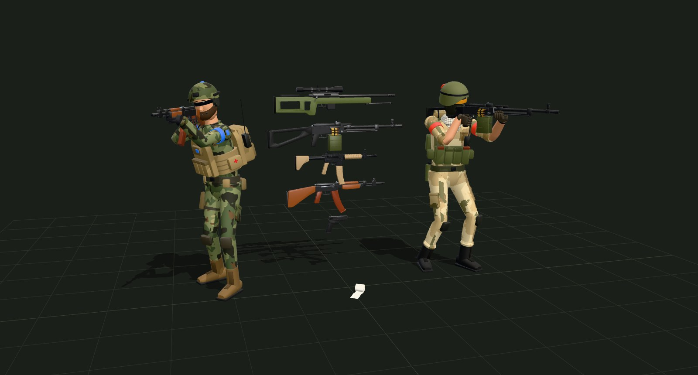
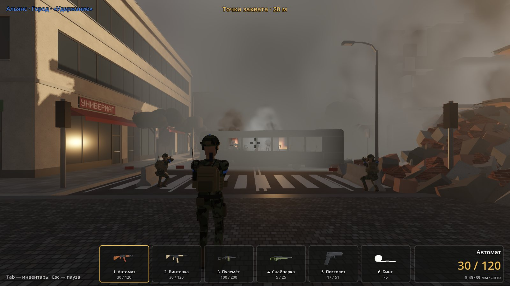
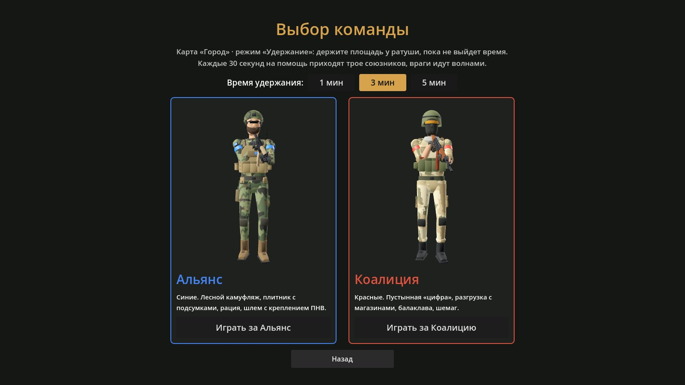
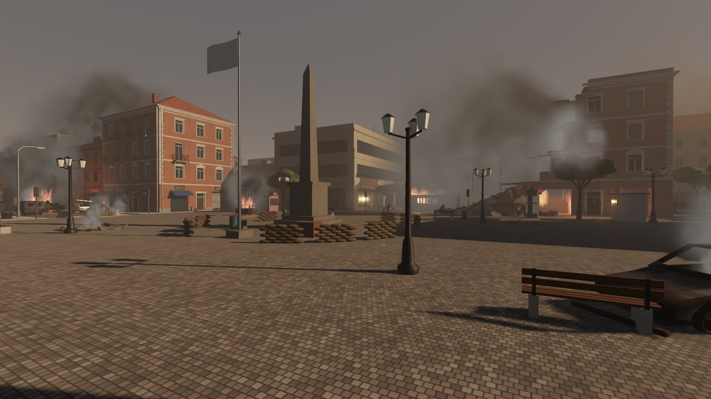
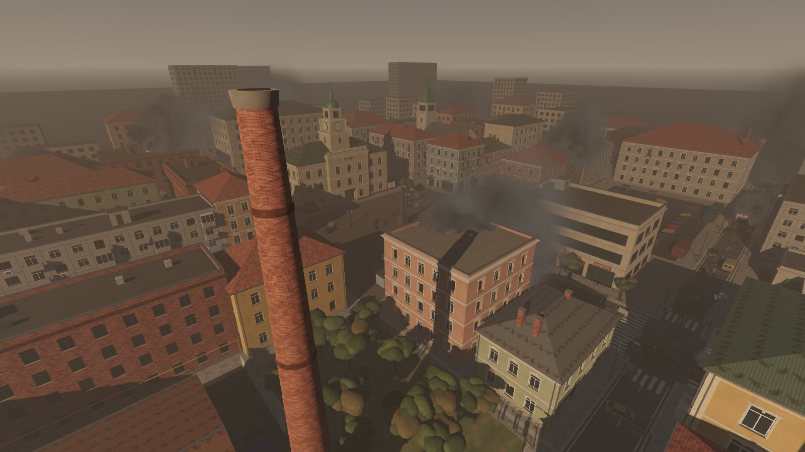
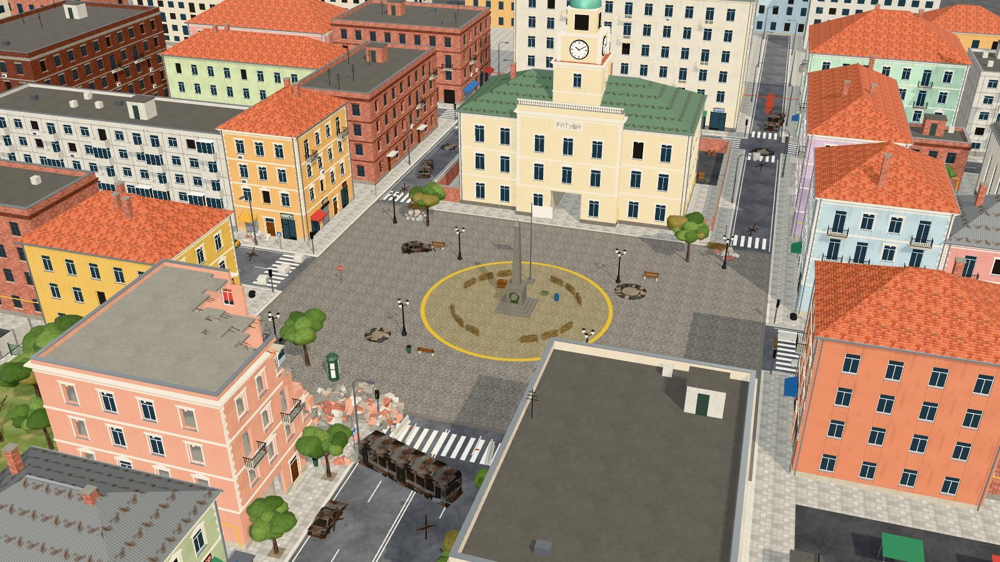
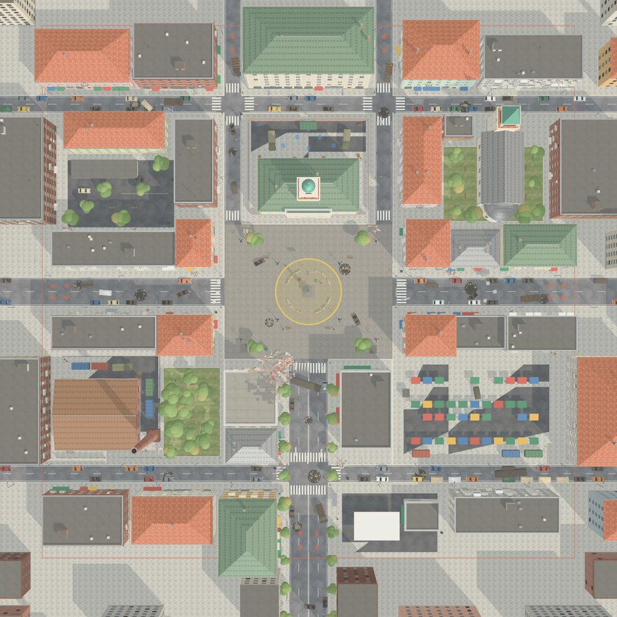
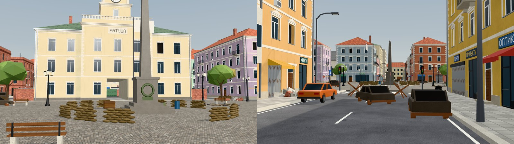
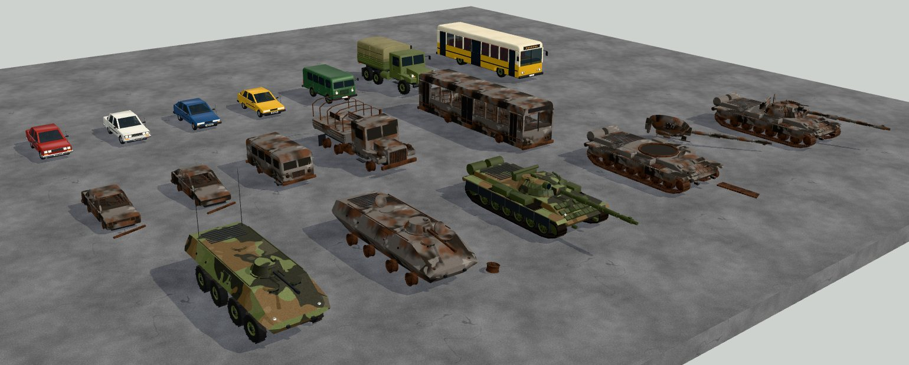
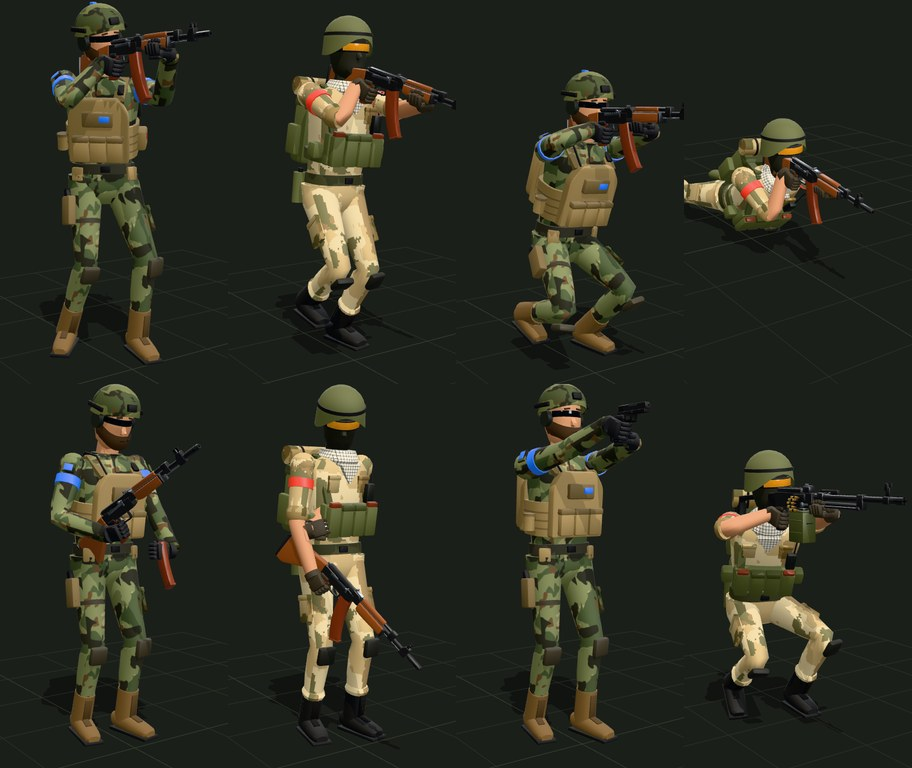

# Battlfield



Игра для ПК в духе Battlefield на **Godot 4**. Готовы low-poly модели (бойцы двух сторон
с анимациями, автомат, винтовка, пулемёт, снайперская винтовка, пистолет, бинт), техника
(легковушки, «буханка», автобус, армейский грузовик, БТР, танк — целые и сгоревшие), карта
«Город» и первый режим — **«Удержание»**: держите площадь у ратуши 1, 3 или 5 минут, каждые
30 секунд на помощь приходят трое союзников, а враги идут волнами со всех сторон. Вокруг идёт
бой: горит подбитая техника, над городом стоят столбы дыма, рвутся снаряды — всё это слышно.



## Что внутри

| Модель | Файл в `godot/assets/models/` | Треугольники | Особенности |
|---|---|---:|---|
| Боец Альянса (синие) | `soldier_alliance.glb` | 14 076 | лесной камуфляж, плитник с подсумками, рюкзак с рацией, шлем с креплением ПНВ, борода, очки |
| Боец Коалиции (красные) | `soldier_coalition.glb` | 12 312 | пустынный «цифровой» камуфляж, разгрузка с магазинами, рюкзак со скаткой и лопаткой, балаклава, шемаг, закатанные рукава |
| Автомат | `assault_rifle.glb` | 3 996 | АК-образный, 5,45 мм; затвор и магазин двигаются |
| Винтовка | `rifle.glb` | 6 494 | M4-образная, 5,56 мм: планка, складной целик, телескопический приклад |
| Пулемёт | `machine_gun.glb` | 5 224 | ПКМ-образный, короб с лентой, сошки |
| Снайперская винтовка | `sniper_rifle.glb` | 4 890 | для разведчика: оптика, сошки |
| Пистолет | `pistol.glb` | 3 428 | полимерная рамка; затвор и магазин двигаются |
| Бинт | `bandage.glb` | 2 516 | рулон марли, свисающий конец — отдельный узел `tail` |

Стороны различаются не только цветом формы, но и силуэтом, чтобы врага можно было узнать
издалека. Цвет команды — на повязках на рукавах, метке на шлеме и стробоскопе Альянса.

## Как открыть в Godot

1. Установите [Godot 4](https://godotengine.org/download) (4.3 или новее, обычная версия — не .NET).
2. В менеджере проектов: **Import** → выберите `godot/project.godot`.
3. Запустите проект (**F5**). Откроется меню: **Играть**, осмотр карты, бойцы с анимациями.

В демо-сцене с бойцами слева выбираются оружие и анимация; правая кнопка мыши вращает камеру,
колесо приближает. При первом открытии Godot импортирует модели, карту и звуки (карта большая —
это займёт около минуты) и создаст папку `.godot/`.

Проект проверен в самом Godot 4.3: импорт, меню, выбор команды, игра (бег, стрельба,
перезарядка, присед, «лёжа», перевязка, инвентарь, пауза) и режим «Удержание» — сотни матчей
целиком в Godot без окна, где игрока заменял бот (подробнее — в разделе о режиме). Картинки в
этом файле сняты в Godot (рендер Forward+). Видеокарты при сборке не было — снимали программным
рендером, поэтому скорость на вашем ПК не измерена; звуки не прослушаны — проверено только, что
они запускаются. Модели и карта проверены валидатором glTF от Khronos (0 ошибок). Если редактор
или игра покажут ошибку, пришлите её текст.

### Играть

**Играть** → выбор времени (1, 3 или 5 минут) и команды (Альянс или Коалиция, оба бойца в 3D)
→ режим «Удержание» на карте «Город». Боец появляется во дворе ратуши, вид — от третьего лица
из-за плеча. В инвентаре всё, что сейчас есть: автомат, винтовка, пулемёт, снайперская
винтовка, пистолет и бинт.



| Клавиши | Действие |
|---|---|
| WASD, Shift | двигаться, спринт |
| C или Ctrl, Z, пробел | присесть, лечь, прыжок (или встать) |
| ЛКМ, ПКМ | стрелять, целиться (у снайперки — оптика) |
| R | перезарядка |
| 1–5, колесо мыши | сменить оружие |
| 6 или H | перевязка бинтом |
| Tab | инвентарь: оружие в 3D, характеристики, патроны; щелчок — взять |
| Esc | пауза: продолжить, сменить команду, главное меню |

Что работает: ходьба, бег и спринт со скоростями под анимации, присед и «лёжа» (у
пулемёта и снайперки раскладываются сошки), прыжок, прицеливание с приближением, стрельба
со вспышкой у дула, трассерами и следами от пуль, свой звук выстрела у каждого оружия, отдача
и разброс, патроны и перезарядка со звуком и анимацией магазина, щелчок пустого магазина,
звон гильз после очереди, урон и здоровье, перевязка, гибель и возрождение, подсказка, сколько
метров до точки захвата и стоите ли вы на ней.

Скрипты: `player.gd` — боец игрока, `hud.gd` — интерфейс и инвентарь, `hold_mode.gd` — режим
«Удержание», `bot.gd` — союзники и враги, `mode_hud.gd` — интерфейс режима, `arsenal.gd` —
характеристики оружия, `effects.gd` — вспышка, следы от пуль и кровь, `game.gd` — выбранные
команда и время (автозагрузка `Game`), `team_select.gd`, `menu.gd`.

### Режим «Удержание»

Держите площадь у ратуши, пока не выйдет время — **1, 3 или 5 минут** (выбирается перед боем).

- **Точка** — круг радиусом 12 м вокруг памятника. Если на точке враги, а защитников нет
  (ни вас, ни союзников), полоса захвата растёт: 3 % в секунду за каждого врага, считаются до
  трёх — втроём враги берут точку за 11 секунд. Только защитники — полоса падает (6 % в
  секунду), и те и другие — стоит. Полоса дошла до 100 % — **поражение**. Время вышло — **победа**.
- **Подкрепление.** Каждые 30 секунд из двора ратуши выходят трое союзников (каждый четвёртый —
  с пулемётом) и занимают свободные позиции: за мешками с песком вокруг памятника или за
  баррикадами на въездах на площадь. Союзников разом не больше 10. Враги начали захват — трое
  ближайших союзников бросают позиции и бегут отбивать точку.
- **Волны врагов.** Первая — на 10-й секунде, дальше каждую 21 секунду: первые две — с одной
  стороны, потом с двух сразу (север, восток, юг, запад — случайно). Волна растёт с 3 до 9
  бойцов; в больших идёт пулемётчик, со второй волны бывает снайпер. Врагов на карте разом не
  больше 16.
- **Боты** ходят по навигационной сетке карты. Бегут, пока никого не видят; увидев — встают,
  разворачиваются и бьют очередями, и чем дольше целятся, тем точнее. Враги наступают
  перебежками: постреляют несколько секунд — и бегом дальше, на бегу отвлекаясь только на тех,
  кто совсем рядом. Дойдя до места, присаживаются и держат его. Бот, по которому стреляют,
  обычно разворачивается к стрелку. Бойцы не толкаются — проходят друг сквозь друга (пули —
  нет), а расходиться ботам помогает навигация.
- **Здоровье** — 100 у всех; ваше попадание в голову — двойной урон. Бинт (6 или H) — +50.
  Погибли — снова в бой через 5 секунд во дворе ратуши, с полным боекомплектом.
- **Снаряды**, падающие на подступах к площади, ранят всех рядом — и врагов, и вас.

Сверху — время (последние 15 секунд — красным), полоса захвата, что происходит на точке, сколько
союзников и врагов на карте и сколько врагов уничтожено (и сколько из них — вами). Внизу слева —
здоровье. Попали по врагу — крестик на прицеле и щелчок (убили — красный крестик); попали по
вам — красные края экрана и глухой удар. Сообщения о волнах и подкреплении — под панелью. В
конце — «Победа» или «Поражение» со статистикой и кнопками «Ещё раз» и «Главное меню».

**Баланс** проверен целыми матчами в Godot без окна, с ускоренным временем. Игрока заменял бот:
в одном случае он ничего не делает (стоит во дворе), в другом — «помогает»: стоит у памятника и
раз в 0,2 секунды с шансом 30 % попадает в ближайшего видимого врага (около 35 урона в секунду,
крепкий, но не идеальный игрок). Доля побед:

| Время | Игрок ничего не делает | Игрок «помогает» |
|---|---:|---:|
| 1 минута | 10 из 10 | 6 из 6 |
| 3 минуты | 11 из 28 (39 %) | 30 из 32 (94 %) |
| 5 минут | — | 19 из 29 (66 %) |

Живой игрок может сыграть и лучше, и хуже — это ориентир: одна минута проходится почти всегда,
три — без вашей помощи союзники чаще не удерживают, пять минут крепкий игрок выигрывает
примерно в двух случаях из трёх. Числа для настройки — в начале `scripts/hold_mode.gd` (волны,
захват, подкрепление) и `scripts/bot.gd` (меткость, дальность, скорость).

### Атмосфера боя



Бой вокруг идёт и в игре, и при осмотре карты (`scripts/battle.gd`). Почти всё это —
декорации: ранят только снаряды, падающие в игре на подступах к площади.

- **Вечер в дыму.** Низкое тёплое солнце с длинными тенями, бурая мгла пожаров у горизонта,
  объёмный туман с лучами, свечение огня и вспышек, приглушённые цвета.
- **Пожары.** Подбитая техника горит: языки пламени, искры, мерцающий отсвет на стенах. Над
  сгоревшими машинами тлеет дымок, над руинами и крышами стоят чёрные столбы дыма, ещё семь — на
  горизонте. Дым сносит ветром на восток, в воздухе летает пепел.
- **Разрывы.** Вдали, за домами — вспышка, дым над крышами и глухой удар с опозданием (звук идёт
  медленнее света). На подступах к площади снаряды падают со свистом: огненный шар, кольцо пыли,
  осколки, тряска камеры.
- **Стрельба.** Очереди вдали, трассеры в небе. При осмотре карты враги ещё и бьют с концов
  улиц по позициям защитников: пули щёлкают над головой, выбивают пыль из стен, рикошетят.
  В игре вместо этого стреляют настоящие враги режима — и пули так же щёлкают над головой.
- **Союзники.** При осмотре карты — шесть бойцов вашей команды за баррикадами на въездах на
  площадь: прячутся, поднимаются и бьют очередями вдоль улиц (один — с пулемётом). В игре их
  место занимают настоящие союзники режима.
- Изредка — осветительная ракета и вой сирены воздушной тревоги.



Звуки слышны с нужной стороны: чем дальше, тем тише и глуше. Фоновый гул боя играет по кругу,
огонь трещит, когда подходишь к нему. Все 28 звуков синтезированы кодом
(`scripts/make-sounds.mjs`): шум, фильтры, огибающие и реверберация улицы с отражениями от
стен — записей с микрофона нет. Текстуры дыма и пламени тоже нарисованы кодом
(`scripts/make-fx.mjs`). Частота событий и громкость — в начале `scripts/battle.gd` и в вызовах
`_schedule`.

Звуки в мире идут не через `AudioStreamPlayer3D`, а через общие плееры на шинах с панорамой
(`scripts/sfx.gd`): громкость и сторона звука считаются один раз, в его начале. Причина — гонка в
звуковом сервере Godot (есть в 4.3, не исправлена и в 4.5): 3D-плеер на каждом шаге микшера
заменяет громкости звука, а старые движок освобождает, не дожидаясь звукового потока. При сотнях
3D-звуков в секунду игра изредка падала; 3D-плеер остался только у треска огня рядом с вами.

### Боец в своей сцене

За бойца отвечает скрипт `scripts/soldier.gd` (класс `Soldier`):

```gdscript
var soldier := Soldier.new()
soldier.model = preload("res://assets/models/soldier_coalition.glb")
add_child(soldier)
soldier.equip(preload("res://assets/models/rifle.glb"))  # оружие в правую руку
soldier.play("Rifle_Jog_Forward")                        # клип с плавным переходом
```

`play()` сам запускает анимации оружия: `Rifle_Reload` — перезарядку магазина, `Rifle_Fire` —
отдачу затвора, а `Bandage` достаёт бинт в левую руку.

## Карта «Город»



Карта для первого режима — **удержание точки от волн врагов**. Защитники держат центральную
площадь, враги идут волнами с четырёх сторон по улицам, переулкам и дворам.

| | |
|---|---|
|  | **Точка захвата** — круг радиусом 12 м вокруг памятника в центре площади (60×48 м). Вокруг памятника — кольцо из мешков с песком, на въездах на площадь — бетонные блоки, ежи и подбитый автобус.<br><br>**Защитники** появляются во дворе ратуши (на севере) и выходят на площадь через арку.<br><br>**Волны врагов** появляются у края карты: **север** — два переулка у ратуши, **восток** — улица Рыночная, **юг** — проспект, **запад** — улица Садовая. Между ними — обходные пути через дворы, парк, рынок и кольцевые улицы. |



- Зона боя — 190×190 м (дальше — невидимые стены), город вокруг — 300×300 м, на горизонте — высотки в дымке.
- 34 дома зоны боя пяти стилей: старый город, «сталинки», кирпичные дома, панельки, универмаг; ориентиры — ратуша с часами, церковь с колокольней, завод с трубой.
- Руины на углу площади: обрушенный угол, этажи без стен, завал из обломков — по нему можно забраться на второй этаж.
- Вывески на русском: «Аптека», «Почта», «Хлеб», «Ратуша»…; остановки, киоски, фонари, деревья, воронки, обломки.
- Техника: машины у тротуаров и брошенные посреди улиц (часть сгоревших), подбитый танк на Рыночной — взрывом сорвало башню, она лежит на тротуаре; сгоревший танк на проспекте, сгоревший БТР на Садовой, БТР защитников во дворе ратуши.
- Файл `godot/assets/maps/city.glb` (31 МБ): у каждого дома свой меш, земля и мелочи — участками 50×50 м (около 370 тыс. треугольников). Техника и деревья — отдельные узлы: копии одной модели делят меш, машины разного цвета — геометрию. Дальние машины Godot сам рисует упрощёнными.

### Техника



Модели — в `src/map/vehicles.js`, на карте они стоят копиями (узлы `car_sedan_3`, `tank_wreck_1`…).

| Модель | Как выглядит | Треугольники (целая / сгоревшая) |
|---|---|---:|
| Седан | «классика» как ВАЗ-2107: прямоугольные фары, хромированные бамперы, колпаки | 5 772 / 4 288 |
| Хэтчбек | трёхдверная «восьмёрка»: клиновидный нос, широкие фары | 5 590 / 4 130 |
| «Буханка» | УАЗ-452: кузов-«батон», круглые фары, окна по бортам | 6 240 / 5 220 |
| Автобус | как ЛиАЗ-677: две краски, большие окна, сиденья в салоне, три двери | 12 184 / 6 606 |
| Грузовик | как «Урал-4320»: капот, крылья с фарами, тент на дугах, три моста | 11 968 / 7 608 |
| БТР | как БТР-80: восемь колёс, башенка с КПВТ, камуфляж | 12 708 / 8 460 |
| Танк | как Т-72Б: «Контакт-1» на башне и лобовом листе, гусеницы из траков, экраны | 17 724 / 16 516 |
| Подбитый танк и его башня | башню сорвало взрывом, гусеница порвана | 12 548 + 2 640 |

У целых машин видно салон сквозь тонированные стёкла. У сгоревших нет стёкол и шин: кузов в
копоти и ржавчине, внутри — рамы сидений, машина осела на диски, у легковушки отвалился бампер.
Деревья — изогнутый ствол с ветвями и крона из нескольких «облаков» листвы.

### Сцена в Godot

`scenes/city.tscn` — карта с окружением боя (низкое солнце с тенями, небо в дыму, туман и
объёмный туман, свечение, SSAO), отметками режима, позициями союзников и наблюдателем. Сцену
собирает `npm run scene` из планировки карты; бой (`battle.gd`) и режим (`hold_mode.gd`) создаёт
`city.gd`. Боты ходят по навигационной сетке `assets/maps/city_nav.res`: её печёт по
столкновениям карты `tools/bake_navmesh.gd` с отступом 0,75 м от стен, чтобы боец не цеплял углы.

| Узел | Что это |
|---|---|
| `Map` | сама карта (`city.glb`). Узлы `collision_*` и `bounds` — столкновения: в `.glb` они названы с суффиксом `-colonly`, и Godot сам превращает их в `StaticBody3D` |
| `Map/fx` | отметки `fx_fire_*`, `fx_smoke_*`, `fx_column_*` — где горит и дымит (масштаб узла — размер очага) |
| `Mode/CapturePoint` | `Area3D` — зона точки захвата (цилиндр 12 м) |
| `Mode/DefenderSpawns` | 6 точек появления защитников (`Marker3D`), смотрят на площадь |
| `Mode/AttackerSpawns/North`, `East`, `South`, `West` | по 4 точки появления врагов для каждого направления |
| `Mode/AllyPosts` | 6 позиций союзников за баррикадами на въездах на площадь, смотрят вдоль улиц |
| `Mode/DefensePosts` | 8 позиций кольцом у памятника, за мешками с песком, лицом наружу |
| `Mode/Debug` | видимые пометки этих точек (при осмотре карты — клавиша M) |
| `Spectator` | наблюдатель для «Осмотра карты»: летает или ходит пешком. В игре его заменяет боец |

Осмотр карты: правая кнопка мыши — смотреть, WASD — двигаться, Q/E — вниз/вверх,
Shift — быстрее, колесо — скорость полёта, **F** — полёт/пешком (пешком действуют гравитация
и столкновения: можно проверить, где пройдёт боец), пробел — прыжок, Esc — в меню.

## Анимации бойцов



В файле каждого бойца 37 клипов. Клипы `Rifle_*` подходят к любому длинноствольному оружию:
у автомата, винтовки, пулемёта и снайперки одинаковая геометрия хвата, поэтому руки всегда
ложатся на рукоять и цевьё.

| Группа | Клипы |
|---|---|
| Стойка и прицел | `Idle` (без оружия), `Rifle_Idle`, `Rifle_Aim`, `Rifle_Aim_Up`, `Rifle_Aim_Down` |
| Шаг | `Rifle_Walk_Forward`, `_Backward`, `_Left`, `_Right` |
| Бег | `Rifle_Jog_Forward`, `_Backward`, `_Left`, `_Right`, `Rifle_Sprint` |
| Присед | `Rifle_Crouch_Idle`, `Rifle_Crouch_Walk_Forward`, `_Backward`, `_Left`, `_Right` |
| Лёжа | `Rifle_Prone_Idle`, `Rifle_Prone_Crawl` |
| Прыжок | `Rifle_Jump_Start`, `Rifle_Jump_Fall`, `Rifle_Jump_Land` |
| Бой | `Rifle_Fire`, `Rifle_Reload`, `Hit`, `Death_Back`, `Death_Forward` |
| Лечение | `Bandage` |
| Пистолет | `Pistol_Idle`, `Pistol_Aim`, `Pistol_Walk_Forward`, `Pistol_Jog_Forward`, `Pistol_Crouch_Idle`, `Pistol_Fire`, `Pistol_Reload` |

Одноразовые клипы: `Rifle_Jump_Start`, `Rifle_Jump_Land`, `Rifle_Reload`, `Pistol_Reload`,
`Bandage`, `Hit`, `Death_Back`, `Death_Forward`. Остальные зациклены. В glTF нет флага
зацикливания, поэтому `soldier.gd` выставляет его сам при загрузке.

Ходьба и бег сделаны на месте: персонажа двигает код. Чтобы ноги не скользили, двигайте его
с такой скоростью:

| Походка | Скорость, м/с |
|---|---:|
| Шаг | 1,0 |
| Бег | 2,65 |
| Спринт | 4,5 |
| Присед | 0,7 |

Анимации оружия: `Reload` есть у всех; `Fire` — у автомата (затвор) и пистолета (кожух-затвор);
`Bipod_Deploy` — у пулемёта и снайперки.

## Соглашения

- Единицы — метры. Ось Y — вверх, Z — вперёд (лицо бойца, ствол оружия), X — влево.
  В Godot у импортированных моделей перёд — это +Z (`Vector3.MODEL_FRONT`), а у камеры −Z.
  Чтобы повернуть бойца к цели, вызывайте `look_at(target, Vector3.UP, true)`.
- Боец стоит в T-позе, подошвы на `y = 0`, рост около 1,8 м. Кости названы как у Mixamo
  (`Hips`, `Spine`, `LeftArm`, `RightUpLeg`…), поэтому скелет легко сопоставить с чужими анимациями.
- Начало координат оружия — в точке хвата правой рукой.

### Точки на оружии

| Узел | Назначение |
|---|---|
| `grip_r` | хват правой рукой; ось +Y узла идёт вдоль рукояти |
| `grip_l` | хват левой рукой: цевьё или рукоять пистолета |
| `sight` | положение глаза при прицеливании (камера в режиме прицела) |
| `muzzle` | дульный срез: вспышка и вылет пули |
| `stock` | точка упора приклада в плечо |
| `eject` | окно выброса гильз |
| `magazine` | магазин или короб — отдельный узел для перезарядки |
| `bolt`, `slide` | затвор автомата и кожух-затвор пистолета |
| `bipod_leg_l`, `bipod_leg_r` | ноги сошек у пулемёта и снайперки |

### Гнёзда бойца

- `socket_weapon_r` — в правой кисти. Чтобы вложить оружие в руку, совместите его узел `grip_r`
  с этим гнездом (так делает `Soldier.equip()`).
- `socket_weapon_l` — в левой кисти: сюда вешается бинт.
- `eyes` — точка между глаз, для камеры от первого лица.

В Godot гнёзда становятся костями скелета; `Soldier` вешает на них `BoneAttachment3D`, и предмет
двигается вместе с кистью.

## Как посмотреть и пересобрать модели и карту

Модели и карта строятся кодом на JavaScript (three.js). Нужен [Node.js](https://nodejs.org) 18
или новее.

```bash
npm install
npm run dev          # просмотрщик: http://localhost:5173
npm run export       # пересобрать всё: godot/assets/models/*.glb и godot/assets/maps/city.glb
npm run export city  # только карту
npm run scene        # сцена godot/scenes/city.tscn
npm run sounds       # синтезировать звуки: godot/assets/sounds/*.wav
npm run fx           # текстуры дыма и пламени: godot/assets/fx/*.png
```

После изменения карты перепеките навигационную сетку для ботов (путь к Godot — свой):

```bash
godot --headless --path godot -s res://tools/bake_navmesh.gd
```

В просмотрщике модель можно вращать, выбрать бойцу оружие и анимацию, разложить сошки,
включить точки крепления и каркас, скачать `.glb`. Карту можно облететь мышью и включить
пометки режима (точка и места появления).

## Как устроен проект

```
godot/                  проект Godot 4
  assets/models/        бойцы, оружие, бинт (.glb)
  assets/maps/city.glb  карта «Город» с техникой; city_nav.res — навигационная сетка для ботов
  assets/sounds/        звуки боя (.wav), assets/fx/ — текстуры дыма и пламени
  scenes/               menu — меню, team_select — выбор команды, city — карта, showcase — бойцы
  scripts/              player.gd — боец игрока, hud.gd — интерфейс и инвентарь, arsenal.gd — оружие,
                        hold_mode.gd — режим «Удержание», bot.gd — боты, mode_hud.gd — интерфейс режима,
                        battle.gd — атмосфера боя, battle_fx.gd — пожары, дым, разрывы, трассеры,
                        sfx.gd — звуки, soldier.gd — модель бойца, spectator.gd — наблюдатель,
                        game.gd, city.gd…
  tools/bake_navmesh.gd навигационная сетка карты
src/map/
  layout.js             планировка: улицы, кварталы, дома, точка захвата, места появления
  buildings.js          генератор домов: фасады, окна, витрины, балконы, крыши, руины
  landmarks.js          ратуша, церковь, завод, гаражи
  vehicles.js           техника: легковушки, «буханка», автобус, грузовик, БТР, танк
  props.js, dressing.js предметы и где они стоят, отметки пожаров
  city.js               сборка карты, столкновения, фон
  textures.js           асфальт, плитка, брусчатка, штукатурка, кирпич, вывески
src/models/
  kit.js                инструменты моделирования: профили, лофты, тела вращения
  materials.js          палитра материалов
  textures.js           процедурные камуфляжи и шемаг
  weapons/              оружие; handling.js — общий хват, перезарядка, сошки
  items/bandage.js      бинт
  soldier/              скелет, тело и снаряжение сторон, IK-риг, анимации
  lineup.js             обзорная сцена со всеми моделями
src/viewer/             просмотрщик
scripts/export-glb.mjs  выгрузка моделей в .glb с проверкой
scripts/make-city-scene.mjs  сцена карты для Godot
scripts/make-sounds.mjs, make-fx.mjs  синтез звуков и текстур эффектов
```

Модели собираются кодом из деталей с размерами в метрах, поэтому их легко менять. Цвета и
камуфляж сторон — в `src/models/soldier/factions.js`, цвета оружия — в `src/models/materials.js`,
дома и улицы карты — в `src/map/layout.js`. После правок выполните `npm run export`.

## Что дальше

- второй режим;
- боты поумнее: укрытия у стен и машин, гранаты, обход с флангов;
- выбор сложности и подсказки на точке (откуда идёт волна).
